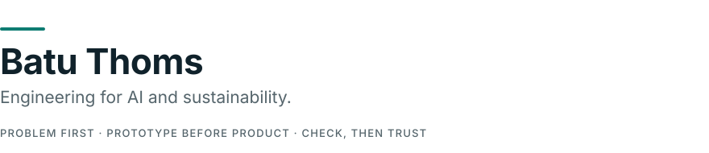

I design and build products, measure how they impact the environment, and build tools that
automate and optimise workflows.

[LinkedIn](https://www.linkedin.com/in/batu-thoms/) · [How I work with AI](https://github.com/batutho-dot/ai-toolkit) · [Project board](https://github.com/users/batutho-dot/projects/1)

 

## Projects

Each one says what it was tested on, what it scored and where it falls short.

### Personal

| | What it is | Result |
|:--|:--|:--|
| **[ai&#8209;toolkit](https://github.com/batutho-dot/ai-toolkit)** | How I set up AI agents so their work can be checked: trust ladder, skills, worker agents, model tiers | Growing |
|  **[danish&#8209;tutor](https://github.com/batutho-dot/danish-tutor)** | Claude Code plugin for spoken Danish practice: a 15 minute conversation, a hidden listening drill, spaced repetition in a local database, and a local app to review and edit your words | No score yet. Ships with invented example data |
| **[energidata&#8209;mcp](https://github.com/batutho-dot/energidata-mcp)** | Gives an AI assistant Danish power data: CO2 intensity, spot price, cleanest and cheapest hours | 10 of 10 test questions, after one fix to my own rounding (9 of 10 before) |
| **[vault&#8209;mcp](https://github.com/batutho-dot/vault-mcp)** | Read-only server over a folder of Markdown notes that refuses every path outside it | 10 of 10 questions, 7 of 7 planted broken links found, in one run |
| **[sustainability&#8209;data&#8209;agent](https://github.com/batutho-dot/sustainability-data-agent)** | One agent that uses two of my data servers together (Danish power data and Eurostat) to answer cross-source questions | 10 of 10 in each of 3 runs on Haiku 5.5 (0.02 USD per run) and on Sonnet 5.5 (0.38 USD per run) |

### Energy

| | What it is | Result |
|:--|:--|:--|
| **[ptx&#8209;dispatch](https://github.com/batutho-dot/ptx-dispatch)** | When should a 10 MW PEM electrolyser run? Hourly dispatch on DK1 spot price and CO2 intensity, Oct 2025 to Sep 2026, parameters from the Danish Energy Agency technology data | Running only in the cheapest 4 h a day cuts electricity cost from 5.82 to 2.81 EUR/kg H2 but raises CO2 from 5.93 to 6.57 kg/kg: in DK1 cheap hours were not the clean hours |
| **[carbon&#8209;aware&#8209;runner](https://github.com/batutho-dot/carbon-aware-runner)** | Starts a heavy computer job in the cleanest window before a deadline, from Energinet's CO2 forecast | Live dry run 2026-11-19: the chosen window was 74% cleaner than starting right away |

### Study

| | What it is | Result |
|:--|:--|:--|
| **[rag&#8209;from&#8209;scratch](https://github.com/batutho-dot/rag-from-scratch)** | Retrieval on EU sustainability law: word counts written by hand in numpy against a small embedding model | 6 of 10 for both at top 5, on different questions |
| **[rag&#8209;eval](https://github.com/batutho-dot/rag-eval)** | Scores that retrieval pipeline on 50 questions, 14 of them with no answer in the texts, graded by a Claude judge | Hybrid search: right passage 27 of 36, right answer 32 of 36, 14 of 14 unanswerable declined. Judge agrees with my hand grades on 22 of 24 |
| **[local&#8209;vs&#8209;claude](https://github.com/batutho-dot/local-vs-claude)** | Three local models on a gaming PC against Claude Haiku 5.5, same questions, same retrieval | A 4B local model matched Haiku: 20 of 20 answers and 10 of 10 declines in all 3 runs, at 2 to 12 times the answer time |

 

## Skills

**AI** &nbsp; `RAG` `embeddings` `vector search` `evaluation` `AI agents` `Claude Code` `MCP servers` `prompt and context design`

**Code and data** &nbsp; `Python` `pandas` `PostgreSQL (learning)` `git`

 

## How I work

**Problem first.** Find the real problem, then pick the tool. 
**Prototype before product.** A small working version before anything big. 
**Check, then trust.** Results get tested before I rely on them. 
**AI as a teammate.** It earns more responsibility as it proves itself. 
**Team over solo.** Goals and deadlines fit the team, not just me.
